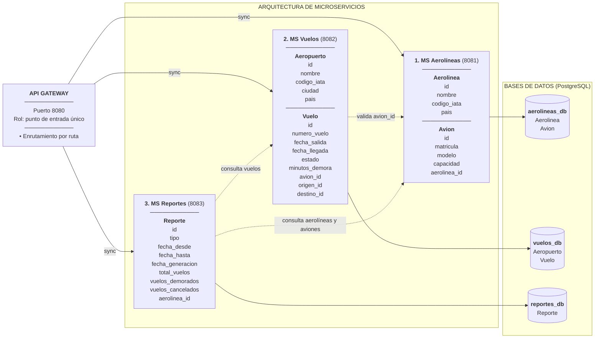

# Reporte de Vuelos

> **Alumnos:** *Acuña, Gerardo y Olea, Exequiel*

Proyecto final de **Desarrollo de Back End** (Tecnicatura en Desarrollo y Calidad de Software, UNSTA).

# 📌 Descripción del Proyecto

**Reporte de Vuelos** es un sistema distribuido basado en una arquitectura de **microservicios**, desarrollado con **Java 25** y **Spring Boot**, que usa **PostgreSQL** para almacenar los datos de cada servicio.

Su objetivo es gestionar de forma centralizada la información de aerolíneas, aviones, aeropuertos y vuelos, y generar reportes estadísticos: vuelos por aerolínea y por período, porcentaje de demoras y cancelaciones, y aeropuertos con más tráfico.

El sistema implementa el patrón **Database per Service** (una base de datos independiente por microservicio) y expone todo a través de un **API Gateway** como punto de entrada único.

---

# 📌 Sprints review

| Fecha | Entrega | Estado |
|---|---|---|
| 29/10 | README, diagrama de clases y diagrama entidad-relación por microservicio | Entregado |
| 05/11 | Aplicación implementada (3 microservicios, gateway y base de datos) | En entrega |
| 12/11 | Documentación del proyecto (estructura, necesidades, etc.) | Pendiente |

---

# Arquitectura del Sistema

El siguiente diagrama muestra el flujo desde el API Gateway hasta las bases de datos, con las entidades y los atributos principales de cada microservicio:



| Servicio | Puerto | Entidades | Responsabilidad |
|---|---|---|---|
| api-gateway | 8080 | - | Entrada única, enruta a los servicios |
| ms-aerolineas | 8081 | Aerolinea, Avion | Flota y datos de cada compañía |
| ms-vuelos | 8082 | Aeropuerto, Vuelo | Rutas, horarios y estados |
| ms-reportes | 8083 | Reporte | Consolida datos y genera estadísticas |

Entre microservicios no hay claves foráneas reales: se guarda solo el `id` (por ejemplo `avion_id` en Vuelo) y se consulta al otro servicio por HTTP con **OpenFeign**.

---

# Diagramas

- [Diagramas de clases por microservicio](docs/diagrama-clases.md)
- [Diagramas entidad-relación por microservicio](docs/diagrama-er.md)

---

# Tecnologías

- Java 25
- Spring Boot 3.5
- Spring Data JPA
- Spring Cloud Gateway
- Spring Cloud OpenFeign (2025.0)
- PostgreSQL
- Maven

---

# Estructura del repositorio

```
reporte-vuelos/
├── api-gateway/        # Spring Cloud Gateway (puerto 8080)
├── ms-aerolineas/      # Aerolinea y Avion (puerto 8081)
├── ms-vuelos/          # Aeropuerto y Vuelo (puerto 8082)
├── ms-reportes/        # Reporte (puerto 8083)
├── docs/
│   ├── diagrama-clases.md
│   ├── diagrama-er.md
│   ├── crear-bases.sql
│   └── ejemplos-api.http
├── pom.xml             # pom padre que agrupa los 4 módulos
└── README.md
```

Cada microservicio sigue la misma estructura de capas: `model` (entidades), `repository`, `dto`, `service`, `controller` y `exception`. Los que se comunican con otros servicios tienen además un paquete `client` con las interfaces de OpenFeign.

---

# Cómo ejecutar

## Requisitos

- JDK 25
- Maven 3.9 o superior
- PostgreSQL (por defecto en `localhost:5432`, usuario `postgres`, contraseña `postgres`)

## Pasos

1. **Crear las bases de datos** (una por microservicio):

   ```
   psql -U postgres -f docs/crear-bases.sql
   ```

   Las tablas se crean solas cuando arranca cada servicio.

2. **Compilar todo** desde la raíz del repositorio:

   ```
   mvn clean package
   ```

3. **Levantar los servicios**, cada uno en su propia terminal y en este orden:

   ```
   java -jar ms-aerolineas/target/ms-aerolineas-1.0.0.jar
   java -jar ms-vuelos/target/ms-vuelos-1.0.0.jar
   java -jar ms-reportes/target/ms-reportes-1.0.0.jar
   java -jar api-gateway/target/api-gateway-1.0.0.jar
   ```

   (También se pueden ejecutar las clases `*Application` desde IntelliJ.)

4. **Probar** la API a través del gateway en `http://localhost:8080` con los ejemplos de [docs/ejemplos-api.http](docs/ejemplos-api.http).

## Configuración

Si la base de datos usa otro usuario o contraseña, se pueden cambiar sin tocar el código con variables de entorno:

| Variable | Para qué sirve | Valor por defecto |
|---|---|---|
| `DB_URL` | URL JDBC de la base del servicio | `jdbc:postgresql://localhost:5432/<base>` |
| `DB_USER` | Usuario de PostgreSQL | `postgres` |
| `DB_PASSWORD` | Contraseña de PostgreSQL | `postgres` |
| `AEROLINEAS_URL` | Dirección de ms-aerolineas | `http://localhost:8081` |
| `VUELOS_URL` | Dirección de ms-vuelos | `http://localhost:8082` |
| `REPORTES_URL` | Dirección de ms-reportes (solo el gateway) | `http://localhost:8083` |

---

# Endpoints

Todos se consumen a través del gateway (`http://localhost:8080`).

## ms-aerolineas

| Método | Ruta | Descripción |
|---|---|---|
| GET | `/aerolineas` | Lista las aerolíneas |
| GET | `/aerolineas/{id}` | Obtiene una aerolínea |
| POST | `/aerolineas` | Crea una aerolínea |
| PUT | `/aerolineas/{id}` | Modifica una aerolínea |
| DELETE | `/aerolineas/{id}` | Elimina una aerolínea (si no tiene aviones) |
| GET | `/aviones` | Lista los aviones (filtro opcional `?aerolineaId=`) |
| GET | `/aviones/{id}` | Obtiene un avión |
| POST | `/aviones` | Crea un avión |
| PUT | `/aviones/{id}` | Modifica un avión |
| DELETE | `/aviones/{id}` | Elimina un avión |

## ms-vuelos

| Método | Ruta | Descripción |
|---|---|---|
| GET | `/aeropuertos` | Lista los aeropuertos |
| GET | `/aeropuertos/{id}` | Obtiene un aeropuerto |
| POST | `/aeropuertos` | Crea un aeropuerto |
| PUT | `/aeropuertos/{id}` | Modifica un aeropuerto |
| DELETE | `/aeropuertos/{id}` | Elimina un aeropuerto (si no tiene vuelos) |
| GET | `/vuelos` | Lista vuelos (filtros opcionales `desde`, `hasta`, `estado`, `avionIds`) |
| GET | `/vuelos/{id}` | Obtiene un vuelo |
| POST | `/vuelos` | Crea un vuelo (valida que el avión exista en ms-aerolineas) |
| PUT | `/vuelos/{id}/estado` | Cambia el estado y los minutos de demora |
| DELETE | `/vuelos/{id}` | Elimina un vuelo |
| GET | `/vuelos/trafico-aeropuertos` | Aeropuertos con más tráfico (`desde`, `hasta`, `limite`) |

Estados de un vuelo: `PROGRAMADO`, `EN_VUELO`, `ATERRIZADO`, `DEMORADO`, `CANCELADO`.

## ms-reportes

| Método | Ruta | Descripción |
|---|---|---|
| POST | `/reportes` | Genera y guarda un reporte (`fechaDesde`, `fechaHasta` y, opcional, `aerolineaId`) |
| GET | `/reportes` | Lista los reportes guardados |
| GET | `/reportes/{id}` | Obtiene un reporte |
| DELETE | `/reportes/{id}` | Elimina un reporte |
| GET | `/reportes/trafico-aeropuertos` | Aeropuertos con más tráfico en un período |

Un vuelo se cuenta como **demorado** si su estado es `DEMORADO` o tiene minutos de demora mayores a 0; los vuelos **cancelados** se cuentan aparte y no cuentan como demorados.

## Errores

Todos los servicios responden los errores con el mismo formato:

```json
{
  "timestamp": "2026-11-05T10:15:30",
  "status": 400,
  "mensaje": "Datos inválidos",
  "errores": { "nombre": "El nombre es obligatorio" }
}
```

| Código | Cuándo |
|---|---|
| 400 | Datos inválidos o una referencia que no existe (por ejemplo, un avión inexistente) |
| 404 | El recurso pedido no existe |
| 409 | Dato duplicado (matrícula, código IATA) o recurso en uso |
| 503 | Otro microservicio no está disponible |
