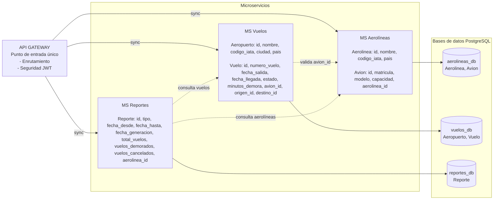

# Reporte de Vuelos

> **Alumnos:** *Acuña, Gerardo y Olea, Exequiel*

Proyecto final de **Desarrollo de Back End** (Tecnicatura en Desarrollo y Calidad de Software, UNSTA).

# 📌 Descripción del Proyecto

**Reporte de Vuelos** es un sistema distribuido basado en una arquitectura de **microservicios**, desarrollado con **Java 25** y **Spring Boot**, que usa **PostgreSQL** para almacenar los datos de cada servicio.

Su objetivo es gestionar de forma centralizada la información de aerolíneas, aviones, aeropuertos y vuelos, y generar reportes estadísticos: vuelos por aerolínea y por período, porcentaje de demoras y cancelaciones, y aeropuertos con más tráfico.

El sistema implementa el patrón **Database per Service** (una base de datos independiente por microservicio) y expone todo a través de un **API Gateway** como punto de entrada único.

---

# 📌 Sprints review

| Fecha | Entrega | Estado |
|---|---|---|
| 29/10 | README, diagrama de clases y diagrama entidad-relación por microservicio | Entregado |
| 05/11 | Aplicación implementada (microservicios, gateway y base de datos) | Pendiente |
| 12/11 | Documentación del proyecto (estructura, necesidades, etc.) | Pendiente |

---

# Arquitectura del Sistema

El siguiente diagrama muestra el flujo desde el API Gateway hasta las bases de datos, con las entidades y los atributos principales de cada microservicio:

| Servicio | Entidades | Responsabilidad |
|---|---|---|
| api-gateway | - | Entrada única, enruta a los servicios |
| ms-aerolineas | Aerolinea, Avion | Flota y datos de cada compañía |
| ms-vuelos | Aeropuerto, Vuelo | Rutas, horarios y estados |
| ms-reportes | Reporte | Consolida datos y genera estadísticas |

Entre microservicios no hay claves foráneas reales: se guarda solo el `id` (por ejemplo `avion_id` en Vuelo) y se consulta al otro servicio por HTTP.

---

# Diagramas

- [Diagramas de clases por microservicio](docs/diagrama-clases.md)
- [Diagramas entidad-relación por microservicio](docs/diagrama-er.md)

---

# Tecnologías

- Java 25 y Spring Boot
- Spring Data JPA
- Spring Cloud Gateway
- OpenFeign
- PostgreSQL
- Maven

---

# Endpoints

> A completar a medida que se implementen.
