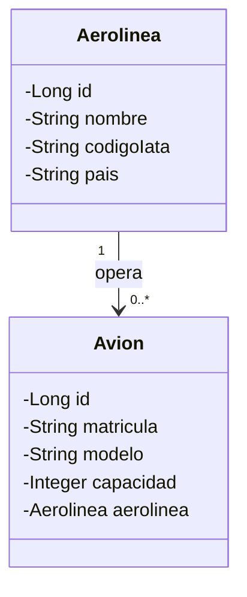
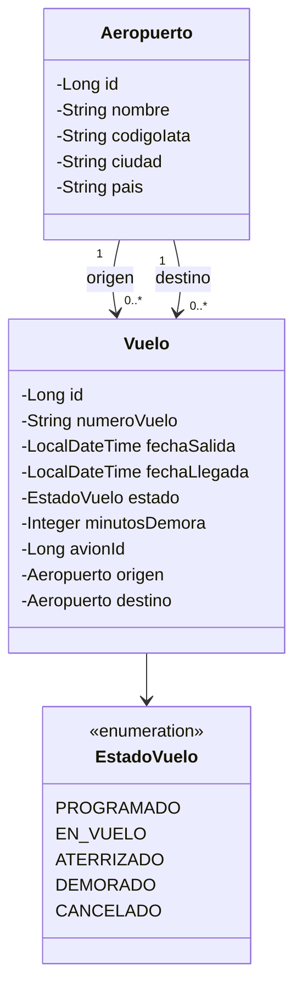
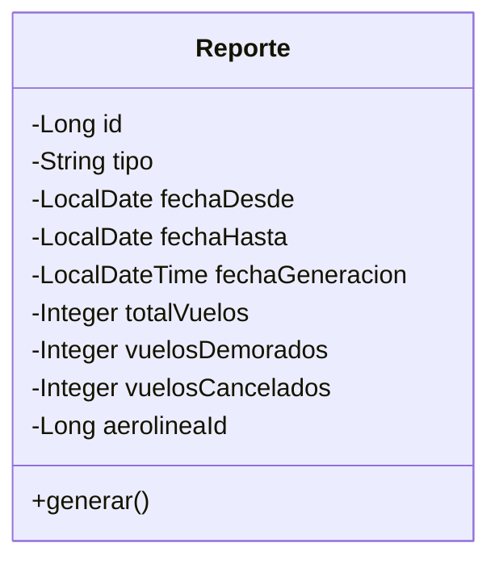
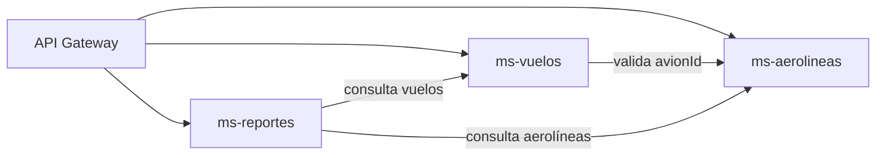

# Reporte de Vuelos - Diagramas de clases por microservicio

Proyecto final de Desarrollo de Back End. Arquitectura de 3 microservicios detrás de un API Gateway, con base de datos PostgreSQL.

## ms-aerolineas

## ms-vuelos

`avionId` referencia a un Avión de ms-aerolineas (no es una clave foránea real).

## ms-reportes

`aerolineaId` referencia a una Aerolínea de ms-aerolineas. Para calcular las estadísticas, `generar()` consulta los datos de ms-vuelos.

## Comunicación entre servicios

## Notas de diseño

- Entre microservicios no hay claves foráneas reales: se guarda solo el `id` y se consulta al otro servicio por HTTP.
- Dentro de un mismo servicio sí hay relaciones JPA (`@ManyToOne` / `@OneToMany`).
- Base de datos PostgreSQL, una por servicio.
