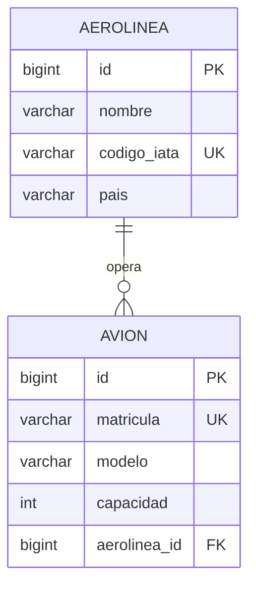
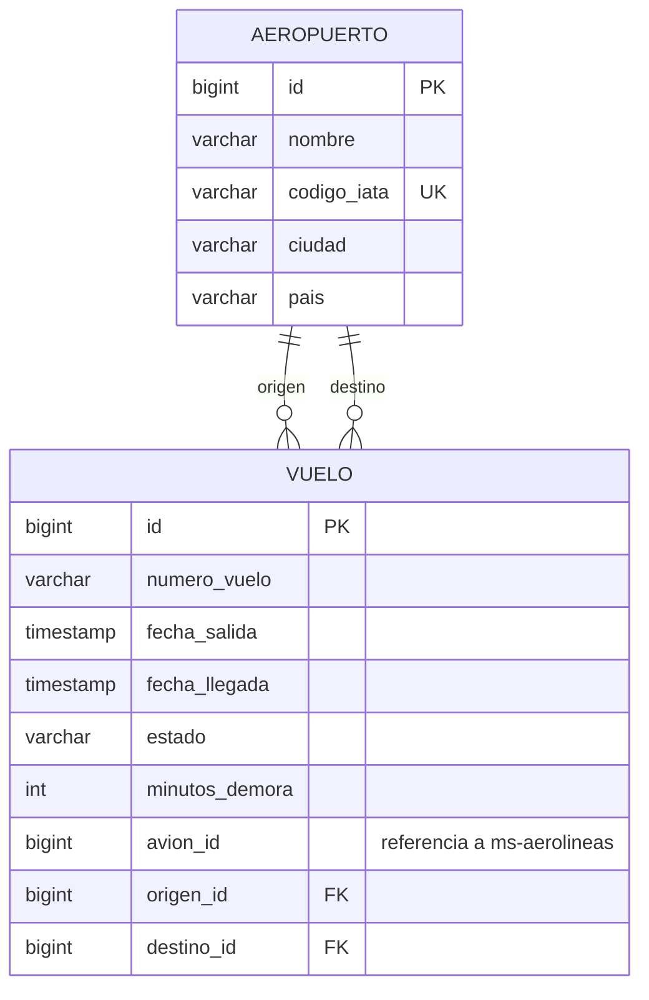
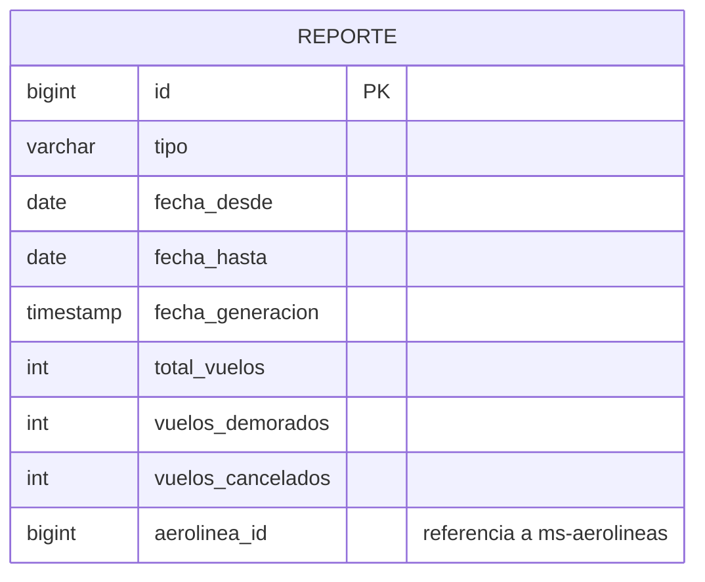

# Reporte de Vuelos - Diagramas entidad-relación por microservicio

Cada microservicio tiene su propia base de datos PostgreSQL.

## ms-aerolineas (aerolineas_db)

## ms-vuelos (vuelos_db)

## ms-reportes (reportes_db)

## Referencias entre servicios

| Campo | Servicio origen | Apunta a |
|---|---|---|
| `vuelo.avion_id` | ms-vuelos | `avion.id` en ms-aerolineas |
| `reporte.aerolinea_id` | ms-reportes | `aerolinea.id` en ms-aerolineas |

Estas referencias no son claves foráneas de base de datos: cada servicio valida el dato consultando al otro por HTTP.
